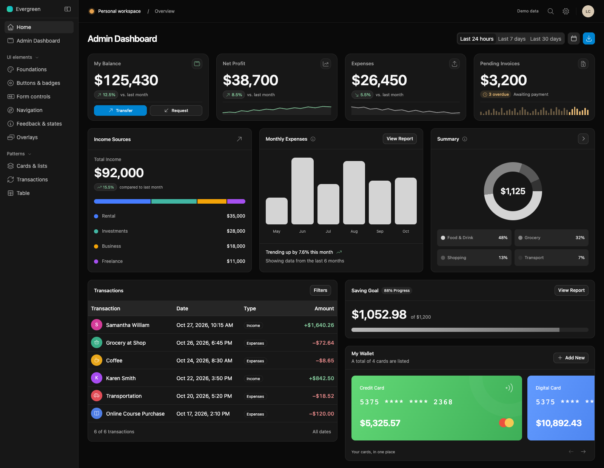

# Admin Dashboard Theme

A responsive admin dashboard and reusable UI kit built with Bootstrap 5, plain HTML, CSS, and vanilla JavaScript. Build your own pages with the blank starter, or adapt the full dashboard and its component examples.

[](https://mzgs.github.io/Admin-Dashboard-Theme/)

**[Live demo](https://mzgs.github.io/Admin-Dashboard-Theme/)** · **[Blank starter](https://mzgs.github.io/Admin-Dashboard-Theme/starter.html)** · **[Download ZIP](https://github.com/mzgs/Admin-Dashboard-Theme/archive/refs/heads/main.zip)**

No build step or package installation is needed to use the theme.

## Contents

- [Features](#features)
- [Quick start](#quick-start)
- [Use it in your site](#use-it-in-your-site)
- [Customization](#customization)
- [JavaScript integration](#javascript-integration)
- [Project files](#project-files)
- [Deployment](#deployment)
- [Browser checks](#browser-checks)
- [Contributing](#contributing)
- [Dependencies and license](#dependencies-and-license)

## Features

- **Responsive layout:** collapsible desktop sidebar, mobile navigation, top bar, and footer.
- **Light and dark themes:** a built-in switch with optional browser storage for the selected theme.
- **Dashboard examples:** metrics, sparklines, income and expense charts, transaction filters, savings progress, wallet cards, and CSV report downloads.
- **UI components:** buttons, badges, form controls, tabs, breadcrumbs, dropdowns, cards, lists, alerts, loading states, and empty states.
- **Interactive patterns:** searchable and paginated tables, date-range pickers, modals, offcanvas panels, tooltips, popovers, and toast notifications.
- **Accessibility features:** skip links, labeled controls, keyboard navigation, overlay focus handling, and reduced-motion styles.

The dashboard uses sample data. Transfers, requests, account details, and form submissions demonstrate the interface; connect your own backend for real application behavior.

## Quick start

Clone the repository, or download and extract the ZIP linked above:

```sh
git clone https://github.com/mzgs/Admin-Dashboard-Theme.git
cd Admin-Dashboard-Theme
```

Open `index.html` in your browser to explore the dashboard and component showcase. You can also serve the folder locally with Python 3:

```sh
python3 -m http.server 8000
```

Then visit:

- Dashboard and components: <http://localhost:8000/>
- Blank starter: <http://localhost:8000/starter.html>

The default setup loads Bootstrap and icons from external URLs, so it needs an internet connection.

## Use it in your site

### Start with a blank page

1. Copy `starter.html`, `style.css`, and `script.js` into your project. Rename the starter to your preferred page name, such as `index.html`.
2. Replace the Evergreen branding, page title, navigation links, and profile details with your own.
3. Add your content inside the starter's empty `<main>` element. For example:

   ```html
   <main id="main" class="dashboard-scroll" tabindex="-1" aria-label="Dashboard content">
     <div class="dashboard-content">
       <section class="dashboard-panel" aria-labelledby="welcome-title">
         <div class="panel-header">
           <h2 id="welcome-title">Welcome back</h2>
         </div>
         <div class="panel-body">
           <p class="mb-0">Your application content goes here.</p>
         </div>
       </section>
     </div>
   </main>
   ```

4. Copy additional components from `index.html`, keeping their labels, IDs, and related markup together. Update IDs and references when using a component more than once.
5. Add your own scripts after `script.js` to load data and handle application actions.

The starter includes assets in this order:

| Stylesheets | Scripts, at the end of the body |
| --- | --- |
| 1. Bootstrap CSS | 1. Bootstrap JavaScript bundle |
| 2. Icon CSS | 2. `script.js` |
| 3. `style.css` | 3. Your application scripts |

Keep this order when integrating the theme into an existing project.

### Reuse individual components

Include the same assets, then copy the component markup into your page. A regular content page can omit the dashboard shell's `dashboard-page` class and `data-sidebar-layout` attribute.

For an overlay or notification, also copy its corresponding `.modal`, `.offcanvas`, or `.toast-container` markup. A button targeting a dialog needs the dialog with the matching ID.

`demo.js` handles showcase forms and preferences; your own pages normally need only `script.js`. The full dashboard's sample behavior also lives in `script.js` and initializes on `.overview-page`. Use `starter.html` for a clean application page.

## Customization

### Colors and styling

Shared design tokens are at the top of `style.css`, with separate dark and light palettes. Add overrides in a stylesheet loaded **after** `style.css`:

```css
/* custom.css */
:root,
[data-bs-theme="dark"],
[data-bs-theme="light"] {
  --primary: #7c3aed;
  --primary-foreground: #ffffff;
  --bs-primary-rgb: 124, 58, 237;
  --bs-link-hover-color-rgb: 124, 58, 237;
  --radius: 10px;
  --control-radius: 10px;
}
```

Other useful tokens include `--background`, `--surface`, `--surface-raised`, `--line`, `--ink`, `--muted`, and `--chart-1` through `--chart-5`. Override surface and text colors separately for each theme to maintain readable contrast.

### Default theme and persistence

Set the initial theme and an optional local storage key on the root element:

```html
<html lang="en" data-bs-theme="light" data-theme-storage="my-site-theme">
```

A button with `.theme-toggle` or `data-theme-toggle` switches themes. With `data-theme-storage` present, the toggle saves the choice and restores it on subsequent visits. Remove that attribute to disable persistence. A saved choice takes precedence over the default theme.

### Navigation and content

- Keep `sidebar-expanded` on the body for an expanded desktop sidebar; remove it to start with the compact rail.
- Replace sample hash links in `starter.html` with real page URLs or IDs that exist in your page.
- For page links, set `.active` and `aria-current="page"` on the current navigation item. Hash navigation updates automatically.
- Replace sample names, amounts, dates, and chart labels together so visual content and accessible descriptions stay consistent.

## JavaScript integration

`script.js` initializes components when the document is ready and exposes `window.AdminUI`:

| Method | Purpose |
| --- | --- |
| `AdminUI.init(root = document)` | Initialize components in a document or element after inserting markup. Repeated calls do not duplicate initialized event handlers. |
| `AdminUI.setTheme('light')` / `AdminUI.setTheme('dark')` | Apply a theme and update toggle labels. This method does not save the selection to storage. |
| `AdminUI.notify(message, target?)` | Show a message in a toast marked `data-ui-toast`, or in a supplied toast element or ID. The toast needs a `.toast-body`. |
| `AdminUI.hideModal(element)` | Close a Bootstrap modal, including one whose opening transition is still running. |

For dynamically inserted content:

```js
const container = document.querySelector('#main');
// Insert your component markup into container first.
AdminUI.init(container);
```

### Component hooks

| Component | Markup and behavior |
| --- | --- |
| Table | Wrap a table in `[data-table]`. Set `data-table-page-size="10"` and optionally `data-table-label="items"`. Controls use `[data-table-search]`, `[data-table-count]`, `[data-table-page-status]`, and buttons with `data-table-page="previous"` or `data-table-page="next"`. |
| Table filters | Use `data-table-filter="status"` on a select and `data-status="active"` on rows. An empty value or `all` includes every status. Search, filtering, and pagination operate on rows already in the DOM. |
| Date range | Copy a `[data-date-range]` example, including `.date-range-trigger`, `[data-date-start]`, and `[data-date-end]`. The hidden inputs hold dates in `YYYY-MM-DD` format. |
| Notifications | Add `data-notify="Changes saved"` to a button and include a toast marked `data-ui-toast`. Use `data-toast-target="toast-id"` to choose another toast. |
| Overlays | Use Bootstrap's `data-bs-toggle` and `data-bs-target`. Add `data-initial-focus` to the preferred focus target, or `data-reset-on-close` to an overlay to reset its forms when closed. |

After adding or replacing table rows, refresh search results and pagination:

```js
document.querySelector('[data-table]').dispatchEvent(new Event('tableupdate'));
```

Listen for date selection changes to update your own data:

```js
document.addEventListener('datechange', (event) => {
  const { start, end, preset, label } = event.detail;
  // Use start and end to request or filter your application data.
  console.log({ start, end, preset, label });
});
```

Other custom events are `pagechange` (`page`, `total`), `segmentchange` (`value`), and `uinotify` (`message`, `target`).

## Project files

| File | Purpose |
| --- | --- |
| `index.html` | Full dashboard demo and component showcase. |
| `starter.html` | Blank layout with sidebar, top bar, theme switch, and footer. |
| `style.css` | Theme tokens, Bootstrap overrides, layout, and component styles. |
| `script.js` | Shared component behaviors, the `AdminUI` API, and dashboard demo logic. |
| `demo.js` | Showcase form handlers and browser-stored workspace preferences. |
| `checks/` | Playwright checks for the dashboard, components, date picker, and overlays. |
| `docs/images/` | README preview images. |

## Deployment

Upload your HTML, CSS, and JavaScript files to a static host, or serve them from your application's public directory. Keep relative asset paths correct when moving files into subfolders. The theme requires no compilation or server-side runtime.

For GitHub Pages, publish the branch and folder containing `index.html` through the repository's **Settings → Pages**. The live demo above is hosted with GitHub Pages.

To host assets locally, replace the external Bootstrap and icon URLs with local copies. Connect your own API, authentication, and persistence as needed; the demo does not provide a backend.

## Browser checks

The theme uses modern browser features, including CSS `color-mix()`, `:has()`, and the native Popover API for the date picker. Use a current Chrome, Edge, Firefox, or Safari release.

Contributors can run the existing checks with Node.js and Playwright. With the local server running on port 8000, open another terminal:

```sh
npm install --no-save --package-lock=false playwright
npx playwright install chromium
node checks/home.cjs
node checks/components.cjs
node checks/date-range.cjs
node checks/overlays.cjs
```

These tools are only needed for browser checks. Set `DASHBOARD_URL` to target another server, or `CHROME_PATH` to use an installed Chrome executable.

## Contributing

Bug reports and pull requests are welcome. Include the browser, screen size, steps to reproduce, and a screenshot when useful. For changes, keep the starter and component examples working in both themes and at desktop and mobile sizes, and run the relevant browser checks.

## Dependencies and license

- **Bootstrap 5.3.8:** CSS and JavaScript bundle loaded from jsDelivr.
- **Font Awesome icons:** loaded from `https://mzgs.github.io/fa7/css/all.css`.
- **Charts:** rendered with CSS and inline SVG; no separate charting library is required.

This repository does not currently include a `LICENSE` file. Third-party libraries and icon assets remain subject to their own licenses.
